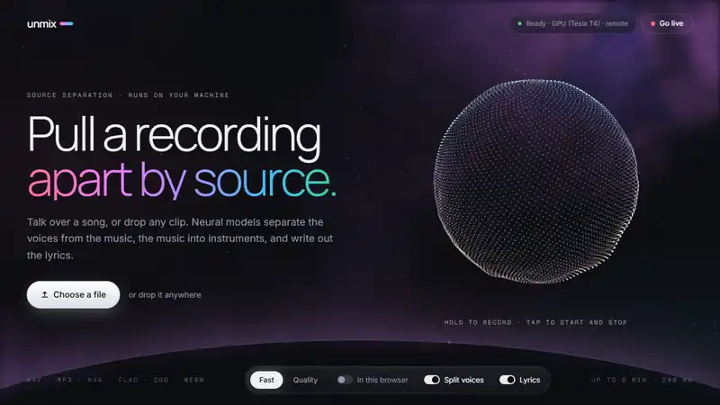
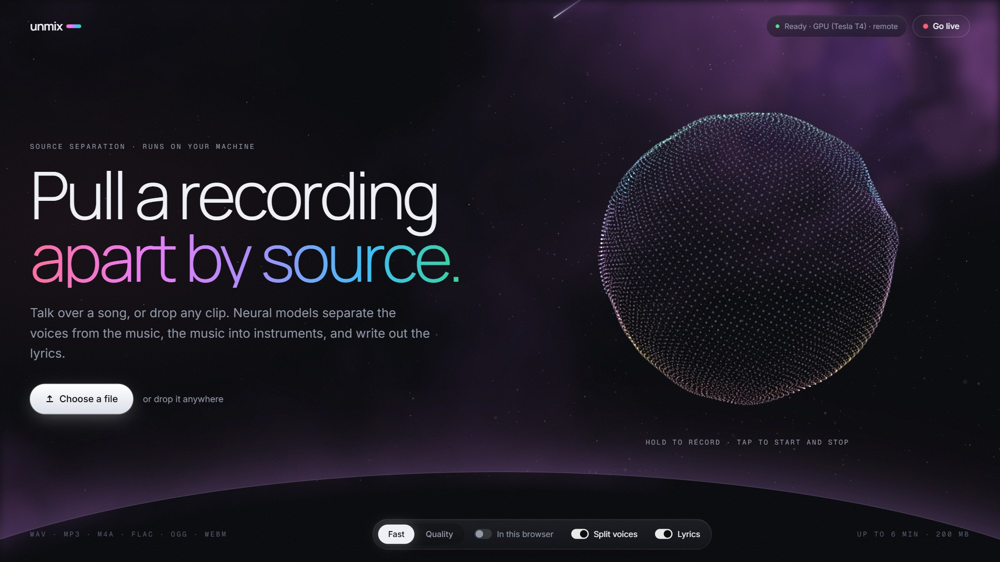
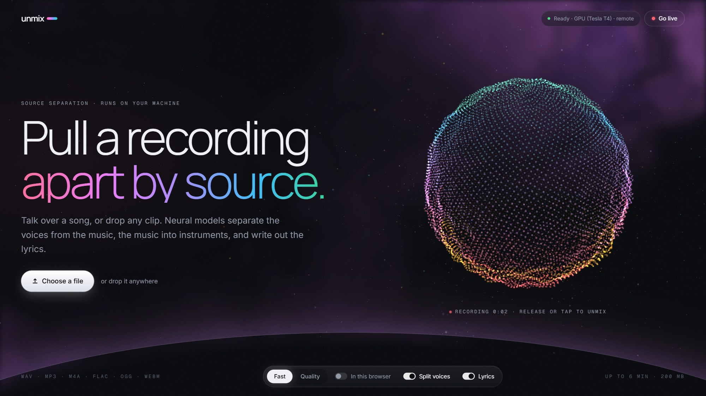
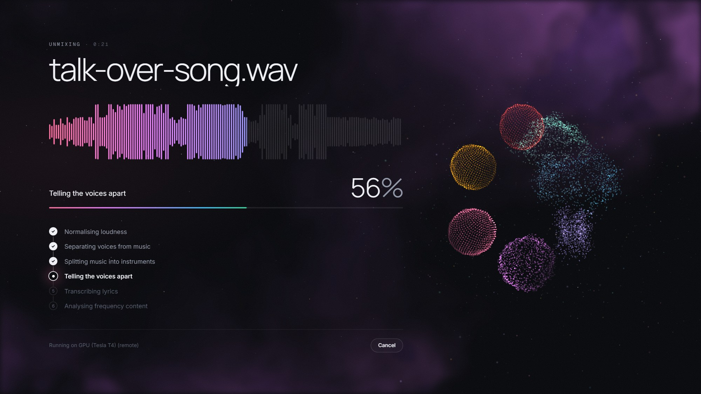
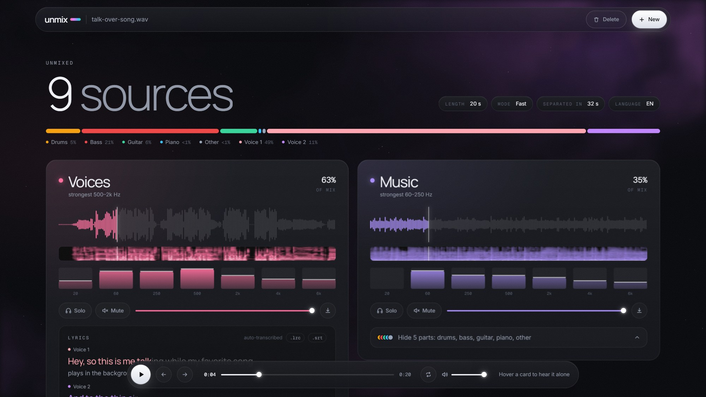
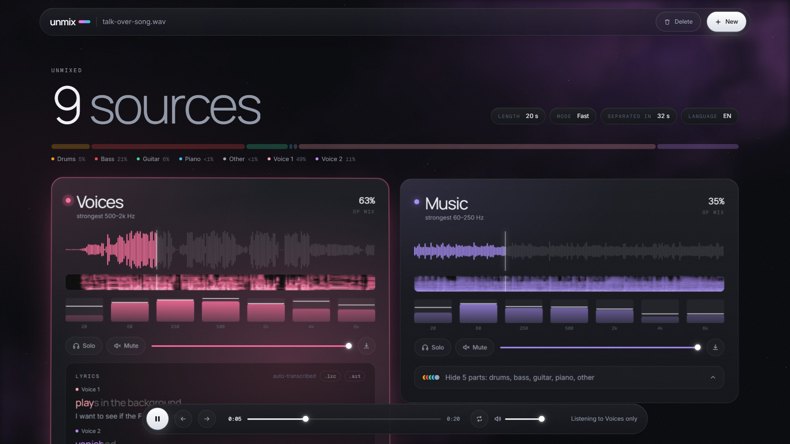
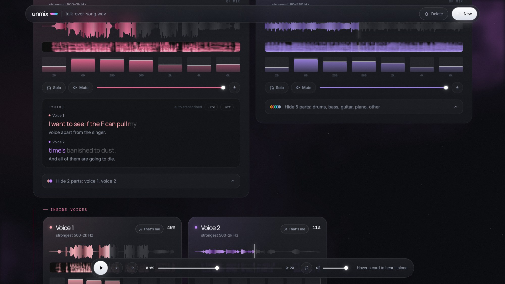
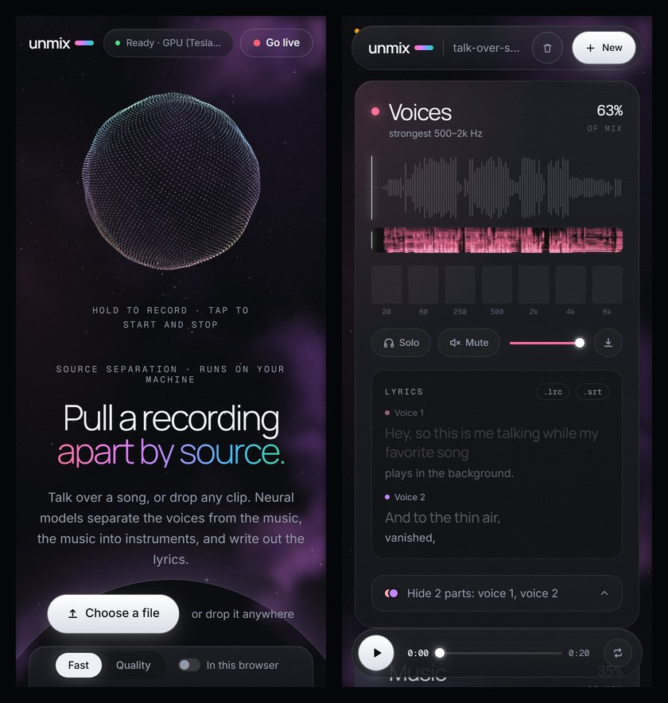

<div align="center">

# unmix

**Pull a recording apart by source.**

Talk over a song, or drop any clip. Neural models separate the voices from the music, the music into drums, bass, guitar, piano and the rest, split your voice from the singer's, and write out the lyrics, word by word.
Free and open source. It runs on your own computer (CPU or GPU), or on a free Colab GPU you start yourself.



<sub>Speech recorded over a song, separated on a Colab T4 GPU (sped up while it waits). <a href="docs/media/demo.mp4">Full demo video (50 s, MP4)</a></sub>

</div>

---

## What it does

| | |
|---|---|
| **Separates by source, not by frequency.** Neural networks predict a mask for each source on the spectrogram (BS-RoFormer / MDX-Net for voices, HT-Demucs for instruments, MossFormer2 for voice against voice). The stems add up exactly to the original. | **Hover to listen.** Every source is a card. Hover one and you hear only that source, with a 150 ms crossfade; move away and the full mix comes back. All stems play sample-locked on one clock. |
| **Your voice vs. the singer.** Talking over a song? "Split voices" separates the two voices too, and "That's me" marks which one is yours. | **Lyrics, word by word.** Whisper transcribes each voice with word timing; the words light up karaoke-style as they play, and clicking a word jumps there. Export as `.lrc` or `.srt`. |
| **See the sound.** Each card has its waveform, a mel spectrogram and a live 7-band meter (sub-bass to brilliance), plus its share of the mix. | **Three ways to run.** On a server on your computer (fast or quality mode), live while you talk (about 7 to 12 s behind on a laptop), or entirely inside the browser (nothing uploaded). |

## A tour

**Hold the sphere to record**, or drop a file anywhere. The sphere's seven bands are the seven frequency bands; while you record they light up and swell with your microphone.





**Unmixing.** Real stage names and progress stream from the server. As the job advances, the sphere's bands bud off one after another into seven small spheres: one recording becoming many sources.



**The stem board.** When it is done, the waveform splits into one strand per source and each strand flies into its card. The bar under the title shows what the mix is made of (hover a segment to hear it).



**Hover = listen.** The card you hover is the only thing playing; the meters follow the music.



**Voice against voice, with lyrics per voice.** Each separated voice gets its own card, colour and lyrics lane.



**On a phone too.** Touch has no hover, so the Solo button does the same job.

<p align="center"></p>

## How it works

```
 your browser (localhost:5173)                     backend (your computer, or a Colab GPU you start)
 +-------------------------------------+  upload  +-----------------------------------------------+
 | record or drop a clip               | -------> | 1 preprocess  decode with ffmpeg, -14 LUFS    |
 | progress (Server-Sent Events)       | <------- | 2 voices      BS-RoFormer / Kim Vocal 2       |
 | stem board: Web Audio, one clock    |  stems,  | 3 music       HT-Demucs (6 or 4 stems)        |
 | WebGL sphere and star field         |  JSON    | 4 speakers    MossFormer2 (optional)          |
 +-------------------------------------+          | 5 lyrics      faster-whisper (optional)       |
                                                  | 6 analysis    peaks, 7 bands, spectrograms    |
                                                  +-----------------------------------------------+
```

- **Residual stems.** `music = mix - voices` and `other = music - (drums + bass + guitar + piano)`, so every level of the tree sums exactly to its parent. That is why "hover solos with a crossfade and returns to the full mix" needs nothing but gain changes.
- **Sample-locked playback.** Every stem is decoded into an `AudioBuffer`, and all of them start with the same `(when, offset)` on one `AudioContext` clock.
- **The GPU is used when it helps.** The start script installs the right build for your hardware (CUDA, DirectML, Apple, CPU), and the server measures each GPU path against the CPU before trusting it; anything that fails falls back to the CPU.

The details: [NOTES.md](NOTES.md) explains the signal processing (STFT, masks, iSTFT, SDR), [docs/ARCHITECTURE.md](docs/ARCHITECTURE.md) the code and the decisions behind it, [DESIGN.md](DESIGN.md) the interface, [SECURITY.md](SECURITY.md) the security model, and [shared/api-contract.md](shared/api-contract.md) the HTTP API.

## Your audio stays yours

- **Everything runs on machines you control.** Clone or fork the repository and it uses your computer, or a Colab session in *your* Google account. There is no central server, no account, no API key for any service, and no analytics or telemetry.
- **Nothing is fetched at run time except open model weights**, downloaded once from their public hosts (Hugging Face, GitHub releases) and checked against pinned SHA-256 hashes. Fonts and scripts are bundled; the page loads nothing from a CDN.
- **Results are deleted after 24 hours**, or at once with Delete. In-browser mode never uploads the audio at all.
- **The backend only answers this computer.** Other websites and other host names are refused (CSRF and DNS-rebinding protection); the optional Colab tunnel requires a random access key that only your local app holds.

## Repository layout

```
backend/    Python 3.12, FastAPI, audio-separator, faster-whisper   -> http://127.0.0.1:8000
  speakers/   separate virtualenv for ClearerVoice (voice splitting, clean-up)
frontend/   React 19, TypeScript, Vite, Tailwind, WebGL2            -> http://localhost:5173
shared/     api-contract.md (the HTTP contract both sides follow)
colab/      unmix_gpu.ipynb (optional: the backend on a free Colab GPU)
docs/       ARCHITECTURE.md, screenshots and the demo video
start.ps1 / start.sh    start both sides with one command
```

## Quick start

```bash
git clone https://github.com/Harsh1tSh/unmix.git
cd unmix
.\start.ps1        # Windows (PowerShell)
./start.sh         # macOS / Linux
```

Then open http://localhost:5173. The first start installs the dependencies and downloads the default models (a few minutes). Details below.

## Prerequisites

| Tool | Version used | Install |
|---|---|---|
| [uv](https://docs.astral.sh/uv/) | 0.6+ | `winget install astral-sh.uv` / `brew install uv` (it fetches Python 3.12 itself) |
| Node.js | 22 | `winget install OpenJS.NodeJS.LTS` / `brew install node` |
| ffmpeg | any recent | `winget install Gyan.FFmpeg` / `brew install ffmpeg` (must be on `PATH`) |

A GPU is optional and used automatically: the start scripts install the right build for your hardware and the server measures what actually works (see "Using a GPU"). No GPU at all? See "Using a free Colab GPU".

## Run it

Both at once, from the repo root:

```powershell
.\start.ps1          # Windows
```
```bash
./start.sh           # macOS / Linux
```

Then open http://localhost:5173. Add `-Fake` (`--fake`) to use instant fake models, which is handy for UI work. The first line printed says which accelerator build was chosen and why; the status line on the start page says what the server runs on (hover it for details).

Or each side in its own terminal:

```bash
cd backend  && uv run uvicorn app.server:app --port 8000     # CPU build; add --no-default-groups --group dml|cuda|cuda12 for a GPU
cd frontend && npm install && npm run dev
```

**First use downloads the models** into `backend/data/models`: about 120 MB for the CPU defaults at start-up, then on first use 460 MB for Whisper `small` (lyrics), 640 MB for MossFormer2 (split voices), 610 MB for BS-RoFormer and 320 MB for `htdemucs_ft` (quality mode or a GPU). On a slow connection the first job with each option waits for its download. `GET /api/health` reports `models_ready`. To fetch everything up front: `cd backend && uv run python scripts/download_models.py --quality`.

### Voice splitting (optional, one-time setup)

Splitting your voice from the singer uses ClearerVoice-Studio, whose dependencies conflict with the rest of the backend, so it has its own environment:

```bash
cd backend/speakers && uv sync      # ~1 GB of packages (its own torch)
```

The backend detects it automatically (`features.speaker_split` in `/api/health`) and the "Split voices" toggle becomes available. Without it everything else works.

## Modes at a glance

| | Where it runs | Stems | Speed on a 4-core laptop CPU |
|---|---|---|---|
| Fast (default) | local server | voices, drums, bass, guitar, piano, other (+ voice split, lyrics) | ~3.3× the clip length (~2× with DirectML on the laptop's MX150) |
| Quality | local server | voices, drums, bass, other | ~28× the clip length |
| Live | local server, streaming | voices, music | CPU: 1.0–1.15× real time, ~12 s behind and the delay can creep up. MX150 via DirectML: 0.27×, ~7.5 s behind |
| In this browser | your browser (WebAssembly, 4 threads) | voices, music | ~6× the clip length; first use downloads the 67 MB model into the browser cache |

Voice **clean-up** (noise and room sound removed from a voice, as a separate file) is a button on each voice card: ~2× the voice's length.

## How long it takes

Measured on the development laptop (Intel i7-8550U, 4 cores, 8 GB RAM, no GPU) with a 45 s clip of a real song:

| Mode | Stage 1 (voices) | Stage 2 (instruments) | Total |
|---|---|---|---|
| `fast` on CPU | Kim Vocal 2: 84 s | htdemucs_6s: 62 s | **147 s (3.3× the clip length)** |
| `fast`, voice model on the GeForce MX150 (DirectML) | Kim Vocal 2: 28–35 s | htdemucs_6s (CPU): 49–73 s | **85–102 s (1.9–2.3× the clip length)** |
| `quality` on CPU (6.8 s clip, first quality job) | BS-RoFormer: 136 s | htdemucs_ft: 55 s | **191 s (28× the clip length)** |

The two DirectML runs differ only in the CPU-bound Demucs stage (the laptop throttles when warm). Quality mode does not benefit from DirectML: its models are PyTorch, which has no current DirectML build.

Optional stages, measured on a 20 s clip of speech over a song:

| Stage | Time | |
|---|---|---|
| Split voices (MossFormer2, CPU) | 368 s | about 17× the clip length: by far the slowest stage on CPU |
| Lyrics (Whisper `small`, int8) | ~10 s per voice | about 0.5× the clip length, plus ~20 s to load the model once |
| Voice clean-up (MossFormer2 SE 48K) | 40 s for a 20 s voice | on demand, per voice card; 212 MB download on first use |

The quality-mode figures include loading BS-RoFormer and `htdemucs_ft`, which happens on the first quality job only (about 15 to 20 s). So on a CPU like this, a 3-minute song takes about 10 minutes in fast mode and well over an hour in quality mode. With a CUDA GPU both modes use BS-RoFormer and will be far faster; run the Colab notebook's benchmark cell to measure it on a T4. Why fast mode uses a different voice model on CPU: `backend/eval/vocal_model_bench.md`.

## Live mode

Click **Go live** on the start page. Your microphone is streamed to the local backend, separated in blocks of 5.75 s and sent back, so you hear the result roughly 12 s later on a laptop CPU. Use **Listen (headphones)**: on speakers the microphone would pick the output up again. When you stop, **Unmix the recording fully** runs it through the normal pipeline (instruments, lyrics); nothing from a live session is kept on the server. While a live session runs, the batch queue waits.

Speed: on this class of CPU, separating one block takes about as long as the block lasts (measured 1.0–1.15× real time), so there is no headroom: if the computer is busy the delay grows, and beyond ~17 s behind the server skips ahead. Any GPU fixes that: the laptop's GeForce MX150 through DirectML does a block in 1.3 s (0.27× real time) and the delay drops to about 7.5 s, which is the floor set by the 5.75 s block size. `scripts/live_probe.py <file.wav>` measures it on your machine.

## In-browser mode

Switch on **In this browser** before choosing a file. The file is decoded, separated (Kim Vocal 2 on onnxruntime-web, WebAssembly with 4 threads) and analysed inside a Web Worker; the stems appear on the normal board and download as WAV files generated in the browser. Only the model is fetched from the local server (67 MB, hash-checked, then cached by the browser). Voices vs. music only: Demucs, Whisper and voice splitting are not run in the browser. The page needs cross-origin isolation for the threads; the dev and preview servers send the headers.

## Use the API directly

```bash
curl -X POST http://127.0.0.1:8000/api/jobs -F "file=@song.mp3" -F "mode=fast" -F "lyrics=true" -F "split_voices=false"
# {"job_id":"<id>"}
curl -N http://127.0.0.1:8000/api/jobs/<id>/events        # live progress (SSE)
curl    http://127.0.0.1:8000/api/jobs/<id>               # status + stem list
curl    http://127.0.0.1:8000/api/jobs/<id>/analysis -o analysis.json
curl    http://127.0.0.1:8000/api/jobs/<id>/lyrics            # word-timed lyrics
curl    http://127.0.0.1:8000/api/jobs/<id>/stems/voices.wav -o voices.wav
```

(In PowerShell use `curl.exe`.) Full contract: [shared/api-contract.md](shared/api-contract.md). Interactive docs at http://127.0.0.1:8000/docs are off by default because they load Swagger UI from a CDN; start the backend with `UNMIX_API_DOCS=1` to enable them.

Limits: 1 s to 6 min, up to 200 MB, wav/mp3/m4a/webm/ogg/flac/aac/aiff only, one job running and at most 3 waiting, results deleted after 24 h (or immediately with Delete). Requests from other websites and other host names are refused; see [SECURITY.md](SECURITY.md).

## Tests

```bash
cd backend
uv run pytest                 # 120 API/pipeline/DSP/security/live/GPU-selection tests with fake models, ~70 s
uv run pytest -m slow -s      # end to end with the real models on a 7 s clip (minutes on CPU)

cd frontend
npm test                      # 30 unit tests: mixing, lyrics, FFT/STFT (matches torch.stft)
npm run typecheck
npx playwright install chromium   # once
npm run test:e2e              # 21 browser tests incl. a fake microphone, live mode and the real model in-browser; own backend on :8010, Vite on :5183
```

### Quality evaluation (SDR)

```bash
cd backend
uv run --group eval python eval/fetch_musdb_sample.py     # free 7-second MUSDB18 preview set, ~140 MB
uv run --group eval python eval/run_eval.py               # 5 clips -> eval/results.md
uv run --group eval python eval/run_eval.py --hq-root /path/to/musdb18hq --clip-seconds 30   # real MUSDB18-HQ
uv run --group eval python eval/bench_vocal_models.py     # speed/SDR of Stage 1 candidates on this machine
uv run python eval/bench_lyrics.py <voices.wav> base small  # Whisper size/settings on a separated vocal
```

The checked-in `eval/results.md` is from the 7-second preview set, not MUSDB18-HQ (a 23 GB download); the script supports both.

### Check a job on disk

`uv run python scripts/check_job.py <job_id>` verifies stems are aligned and sum back to the mix, and prints energy shares.

## Configuration

Environment variables read by the backend (defaults in `backend/app/config.py`):

| Variable | Default | Meaning |
|---|---|---|
| `UNMIX_FAKE_MODELS` | `0` | `1` = DSP filters instead of neural models (tests, UI work) |
| `UNMIX_VOCAL_MODEL` | `model_bs_roformer_ep_317_sdr_12.9755.ckpt` | Stage 1 model |
| `UNMIX_VOCAL_MODEL_CPU_FAST` | `Kim_Vocal_2.onnx` | Stage 1 model for `fast` mode on CPU-only machines. Set to an empty string to always use BS-RoFormer |
| `UNMIX_VOCAL_MODEL_FALLBACK` | `model_mel_band_roformer_ep_3005_sdr_11.4360.ckpt` | used if the Stage 1 model cannot be loaded |
| `UNMIX_MUSIC_MODEL_FAST` / `_QUALITY` | `htdemucs_6s.yaml` / `htdemucs_ft.yaml` | Stage 2 models |
| `UNMIX_LYRICS_MODEL` | `small` | Whisper size: `base` is faster, `medium` more accurate and much slower on CPU |
| `UNMIX_LYRICS_LANGUAGE` | (auto) | force a language code, e.g. `en`, if detection guesses wrong |
| `UNMIX_SPEAKERS_PYTHON` | `backend/speakers/.venv/...` | python of the voice-splitting environment |
| `UNMIX_DATA_DIR` | `backend/data` | jobs, SQLite file, model cache |
| `UNMIX_MODELS_DIR` | `<data dir>/models` | model cache only |
| `UNMIX_MAX_DURATION_S` / `UNMIX_MAX_UPLOAD_MB` | `360` / `200` | upload limits |
| `UNMIX_TARGET_LUFS` | `-14` | loudness normalisation target |
| `UNMIX_JOB_TTL_HOURS` | `24` | how long results are kept |
| `UNMIX_CORS_ORIGINS` | Vite dev/preview origins | extra allowed origins (any localhost port is always allowed) |
| `UNMIX_ALLOWED_HOSTS` | `localhost,127.0.0.1,[::1],testserver` | `Host` headers the API answers (DNS-rebinding protection) |
| `UNMIX_MAX_WAITING_JOBS` | `3` | queued + running jobs before new uploads get 429 |
| `UNMIX_STRICT_MODELS` | `0` | `1` = refuse model files that are not in the pinned hash manifest |
| `UNMIX_API_DOCS` | `0` | `1` = serve `/docs` (loads Swagger UI from a CDN) |
| `UNMIX_DEVICE` | `auto` | `cpu` = never use a GPU; `cuda` / `mps` = insist on one |
| `UNMIX_ONNX_PROVIDER` | `auto` | `cpu`, `cuda` or `directml` for the ONNX voice model instead of measuring |
| `UNMIX_ACCEL_REPROBE` | `0` | `1` = measure the GPU back ends again (after a driver update) |
| `UNMIX_MIN_CUDA_VRAM_GB` | `3.5` | smaller CUDA GPUs keep the PyTorch models on the CPU |
| `UNMIX_REMOTE_KEY` | (none) | remote mode: every request must carry this key (24+ characters) |
| `UNMIX_STEM_TRANSPORT` | `wav` | `flac` = stream stems as lossless FLAC (half the size, for remote servers) |

Start scripts: `UNMIX_ACCEL` (or `-Accel` / `--accel`) = `cpu`, `dml`, `cuda` or `cuda12` overrides the build choice. Frontend: `UNMIX_BACKEND_URL` (default `http://127.0.0.1:8000`) is where the Vite dev/preview server proxies `/api`; `UNMIX_BACKEND_KEY` is the access key it adds to every proxied request (set by `start.ps1 -Remote`).

## Using a GPU

Nothing to configure. Two things happen automatically:

**1. The start script installs the matching build** (`backend/scripts/pick_accel.py`):

| Your machine | Build (`uv` group) | What runs on the GPU |
|---|---|---|
| NVIDIA RTX 20-series / T4 or newer, driver with CUDA 13 | `cuda` (torch 2.15 + CUDA 13.2) | everything: separation, voice splitting, lyrics, live |
| NVIDIA GTX 900/10-series or newer, CUDA 12 driver | `cuda12` (torch 2.14.1 + CUDA 12.6, the last CUDA 12 release) | everything except voice splitting / clean-up (their torchaudio exists only for CUDA 13) |
| Windows, any other GPU (Intel, AMD, small or old NVIDIA) | `dml` (onnxruntime-directml) | the fast voice model and live mode |
| Mac with Apple Silicon | `cpu` (torch includes Apple's GPU back end) | separation |
| anything else | `cpu` | nothing |

NVIDIA cards with under 3.5 GB of memory (e.g. the MX150) use `dml` on Windows: BS-RoFormer does not fit, but the voice model does. An old NVIDIA driver also leads to `dml`, with a hint to update it.

**2. The server measures before it trusts** (`backend/app/accel.py`). At first start it times the voice model on each GPU back end the installed build offers, in a separate process (a broken driver can take a process down), compares the output with the CPU's, and keeps the fastest one that is correct; the result is cached in `data/models/accel.json`. PyTorch must pass a test kernel on the GPU, and Whisper is tried on CUDA in a child process before the server uses it. If a GPU fails during a job (out of memory, driver reset), that step is redone on the CPU and the server stays on the CPU until restarted; the reason shows in `/api/health` → `accelerator.notes` and when hovering the status line. `cd backend && uv run python -m app.accel` prints what would be chosen and why.

The CUDA builds are tested by the unit tests (simulated GPUs and failures) but have not yet run on real NVIDIA CUDA hardware: the Colab notebook's benchmark cell is the first real check, and its numbers belong in the table above.

Measured on the development laptop (i7-8550U + GeForce MX150 2 GB, 2020 driver 451.67): the voice model takes 1.1 s per window through DirectML against 5.3–8.2 s on the CPU; the Intel UHD 620's DirectML driver fails and is skipped automatically. A second DirectML session in one process hangs this GPU, which is why fast mode and live mode share one session.

## Using a free Colab GPU

No GPU, or want quality mode fast? Run the backend on Google Colab's free T4 GPU and keep using the app on your computer:

1. Open [`colab/unmix_gpu.ipynb`](colab/unmix_gpu.ipynb) in Colab (*File → Upload notebook*, or open it from GitHub).
2. Running your own fork? Set `REPO` in the first cell to it. Only if that repository is private: add a Colab secret `GITHUB_TOKEN` (fine-grained token, read-only *Contents* on it).
3. *Runtime → Change runtime type → T4 GPU*, then *Run all*. About 5 minutes the first time.
4. Run what it prints, in the Unmix folder: `.\start.ps1 -Remote https://<name>.trycloudflare.com` (or `./start.sh --remote ...`) and paste the access key when asked.

The status line then reads "Ready · GPU (Tesla T4) · remote". Everything works as locally, including live mode; in-browser mode still runs in your browser.

How it works: the notebook starts the backend on the Colab machine and a temporary [Cloudflare quick tunnel](https://developers.cloudflare.com/cloudflare-one/connections/connect-networks/do-more-with-tunnels/trycloudflare/) to it (no account needed). The tunnel address is public, so the backend requires a random access key on every request; only your local frontend proxy knows it. Stems travel as lossless FLAC (half the size of WAV); downloads are still WAV. Uploads are limited to 95 MB by Cloudflare. If the progress stream is held back by the tunnel, the app polls instead.

Limits and privacy: free sessions last at most 12 hours and stop when idle; Colab may also end sessions that serve web apps, in which case run the notebook again (new address and key). Your audio leaves your computer in this mode: it is uploaded to Google's machine through Cloudflare (encrypted) and deleted when the session ends. Details in [SECURITY.md](SECURITY.md).

## Troubleshooting

- **"Backend not reachable"** in the UI: the backend is not running, or still importing PyTorch (takes 10 to 30 s on a cold start). In remote mode: the Colab session ended; run the notebook again.
- **First start takes a minute longer than usual**: the server is measuring the GPU back ends (once; cached in `data/models/accel.json`).
- **The GPU is not used**: hover the status line on the start page, or run `cd backend && uv run python -m app.accel`. Common reasons: an old NVIDIA driver (update it, then restart), a card with under 3.5 GB of memory, or `UNMIX_DEVICE=cpu`.
- **`uv run pytest` reinstalls PyTorch**: plain `uv run` uses the CPU build. On a GPU machine run tests with the same group the start script chose, e.g. `uv run --no-default-groups --group dev --group dml pytest`.
- **Passing flags through npm in PowerShell**: `npm run dev -- --port 3000` loses the flags in Windows PowerShell 5. Use `npx vite --port 3000`.
- **Vitest fails with `Cannot read properties of undefined (reading 'config')`**: the shell's working directory has a lower-case drive letter (`d:\...`). `npm test` works around it; if you call `npx vitest` directly, `cd D:\...` first.
- **Out of memory**: BS-RoFormer needs about 2 GB of RAM. On an 8 GB machine close other apps before using quality mode.
- **"Split voices" is greyed out**: the voice-splitting environment is not installed; see "Voice splitting" above.
- **Lyrics are wrong for a song**: Whisper is a speech model and mishears sung words, especially under effects. Splitting the voices first helps when you talk over the song. Try `UNMIX_LYRICS_MODEL=medium` if you can wait.
- **The orb says microphone access was blocked**: allow the mic for `localhost` in the browser's site settings. Recording needs `localhost` or HTTPS.
- **Live mode keeps falling behind**: the CPU cannot separate faster than real time. Close other apps; the live screen shows the speed (above 1.0× = falling behind).
- **In-browser mode says the model is not on the server**: it is downloaded by the first normal job (or `scripts/download_models.py`).
- **Port 8000 still in use after stopping**: `Get-Process python | Stop-Process` (Windows) or `pkill -f uvicorn`.

## Credits and licences

The code in this repository is under the [MIT licence](LICENSE). The models are not part of it: they are downloaded from their own projects and keep their own licences.

Models are downloaded by [audio-separator](https://github.com/nomadkaraoke/python-audio-separator) (UVR model zoo): BS-RoFormer weights by viperx, Kim Vocal 2 by KimberleyJSN, HT-Demucs by Meta. MossFormer2 by Alibaba's [ClearerVoice-Studio](https://github.com/modelscope/ClearerVoice-Studio); Whisper by OpenAI via [faster-whisper](https://github.com/SYSTRAN/faster-whisper). Check each model's licence before any use beyond personal experiments. The song used for verification is "Let's Pretend" by Josh Woodward (CC BY 4.0).
